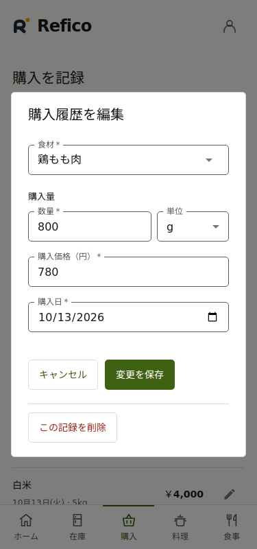
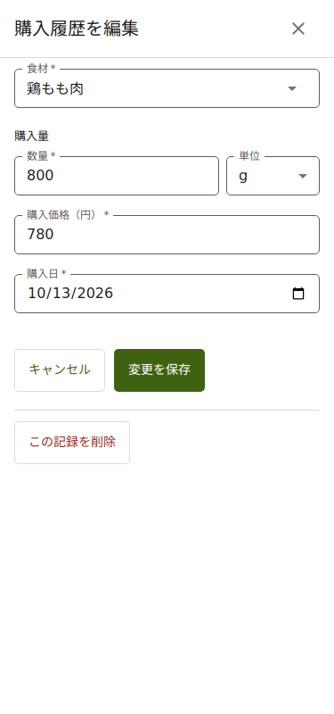

# UI/UX改善の検証

## 変更前後

375px幅の購入履歴編集。APIをテスト内で代替し、同じサンプルデータを使用。
変更前はdevの `b4c1fad`。日本語フォントを利用したChromiumで撮影した。

| 変更前                                          | 変更後                                     |
| ----------------------------------------------- | ------------------------------------------ |
|  |  |

スマートフォンでは入力幅を確保し、見出しと閉じる操作を上部に保持する。PCは中央ダイアログを維持する。保存操作は入力末尾のまま。

## 自動検証

`pnpm check`・`pnpm test`・`pnpm build`、UIの型チェックを含む `pnpm test:ui` を実行する。
PlaywrightはAPIを代替するため、外部のスペースや認証に依存しない。
CIにもChromiumのインストールとUIテストを追加。
検証環境はPlaywright 1.64.0とChromium 134のHeadless Shell。
ブラウザの取得制約によりローカルでは `PLAYWRIGHT_CHROMIUM_EXECUTABLE_PATH` で指定した。CIではPlaywrightに対応するChromiumをインストールする。

| チェック                           | 結果      |
| ---------------------------------- | --------- |
| 型チェック                         | 成功      |
| 既存テスト                         | 141件成功 |
| ビルド                             | 成功      |
| UI型チェック・Playwright           | 12件成功  |
| axe（購入履歴編集、5幅・両テーマ） | 違反0件   |

- 320・375・600・601・1280px × ライト・ダークの10ケース。
- 600px以下の全画面、601px以上の中央表示、短い削除確認の中央表示。
- カレンダーの正確な金額全文（12,345,678円を含む）、記録済み0円、意図しない横スクロール。
- 購入・食事・料理の履歴編集、Esc、ブラウザの戻る、フォーカス復帰、一覧スクロール位置、タブ間の入力保持。
- 閉じるボタンの48px領域、Tabのフォーカストラップ、axeのWCAG A/AAチェック（購入履歴編集、両テーマ）。
- 両テーマで文字200%相当、400px高への表示領域縮小、固定見出し、食材追加との入れ子、保存エラーと入力保持、保存中の戻る禁止、成功トースト。

## 実機での確認が残る項目

- iOS/Androidのソフトウェアキーボード、IME入力、ブラウザツールバーとセーフエリア。
- VoiceOver/TalkBackによる読み上げ順と実際の操作感。
- Safari/WebKitでの実描画。自動検証はChromiumで実行した。

visualViewportへの追従と `interactive-widget=resizes-content` を実装したが、画面高の縮小テストは実際のソフトウェアキーボードの代替検証に留まる。
7列を維持するカレンダーは狭い画面でセル幅が48px未満になる。高さ72px以上を保ち、金額を省略せず桁区切りで折り返し、文字拡大時には必要に応じて桁内も折り返す。
